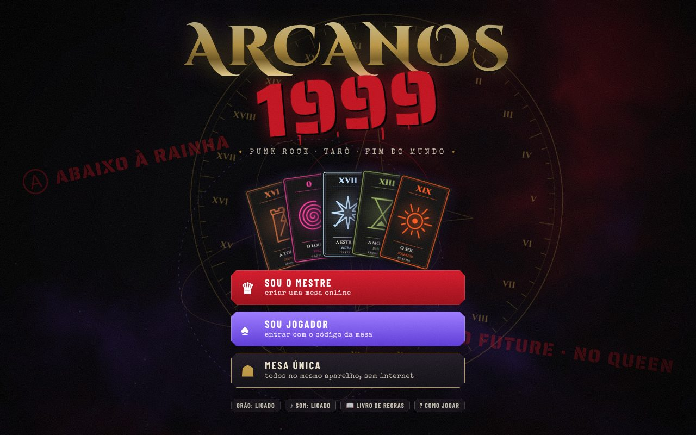

# ARCANOS: 1999 — Mesa Online

> Punk rock, tarô e fim do mundo. Um RPG de mesa jogável no navegador, com Mestre e jogadores conectados em tempo real.



**Arcanos: 1999** é um RPG de mesa original (projeto acadêmico de *Lore de RPG*, por **Nicolas Rocha**). Esta pasta contém a versão digital: um site de **um único arquivo** (`index.html`) que funciona no computador e no celular, sem instalar nada e sem servidor próprio.

---

## O que vem neste pacote

```
arcanos-1999/
├── index.html                        ← o jogo inteiro (HTML + CSS + JS + dados do livro)
├── .nojekyll                         ← diz ao GitHub Pages para servir os arquivos como estão
├── preview.jpg                       ← imagem de capa deste README
├── README.md                         ← este arquivo
└── livro/
    └── Arcanos_1999_Livro_de_Regras.pdf   ← o livro de regras completo
```

---

## Jogar agora, sem publicar nada

1. Abra o `index.html` no navegador (Chrome, Edge, Firefox ou Safari).
2. Escolha uma opção:
   - **Mesa única:** todo mundo no mesmo aparelho (TV, projetor ou tela compartilhada no Discord). Não precisa de internet.
   - **Sou o Mestre / Sou jogador:** multiplayer online. Precisa de internet. Funciona mesmo abrindo o arquivo direto no computador, mas **no celular só funciona se o jogo estiver publicado** (veja abaixo), porque celulares não abrem arquivos HTML locais direito.

---

## Publicar no GitHub Pages (grátis)

Assim o jogo ganha um link fixo, tipo `https://seu-usuario.github.io/arcanos-1999/`, que abre em qualquer celular.

### Opção A — Pelo site do GitHub (sem usar terminal)

1. **Crie uma conta** em [github.com](https://github.com) (se ainda não tiver).
2. Clique em **+** (canto superior direito) → **New repository**.
   - **Repository name:** `arcanos-1999` (ou o nome que quiser; ele vira parte do link).
   - Marque **Public**. O GitHub Pages grátis só funciona em repositórios públicos.
   - Clique em **Create repository**.
3. Na página do repositório vazio, clique no link **uploading an existing file**.
4. **Extraia o zip no seu computador** e arraste **o conteúdo** da pasta `arcanos-1999` (o `index.html`, a pasta `livro`, o `README.md`, o `preview.jpg`) para a área de upload.
   - Atenção: arraste os **arquivos de dentro da pasta**, não a pasta em si. O `index.html` precisa ficar na raiz do repositório.
   - O `.nojekyll` é um arquivo oculto. Se ele não aparecer para arrastar, tudo bem: o jogo funciona sem ele.
5. Lá embaixo, clique em **Commit changes**.
6. Vá em **Settings** (aba do repositório) → **Pages** (menu da esquerda).
7. Em **Build and deployment → Source**, escolha **Deploy from a branch**.
8. Em **Branch**, escolha **main** e a pasta **/ (root)**. Clique em **Save**.
9. Espere de 1 a 3 minutos e recarregue a página. Aparece no topo: **"Your site is live at https://seu-usuario.github.io/arcanos-1999/"**.

Pronto. Esse é o link do jogo. O livro em PDF fica em `https://seu-usuario.github.io/arcanos-1999/livro/Arcanos_1999_Livro_de_Regras.pdf`.

### Opção B — Pelo terminal (git)

```bash
# dentro da pasta extraída
cd arcanos-1999
git init
git add .
git commit -m "Arcanos: 1999 — mesa online"
git branch -M main
git remote add origin https://github.com/SEU-USUARIO/arcanos-1999.git
git push -u origin main
```

Depois faça os passos **6 a 9** da Opção A (Settings → Pages → main / root).

### Atualizar o jogo depois

Substitua o `index.html` no repositório (**Add file → Upload files**, arraste o novo e faça commit). O GitHub Pages republica sozinho em 1 ou 2 minutos. Se o navegador mostrar a versão antiga, recarregue com **Ctrl+Shift+R** (no celular, feche e abra a aba de novo).

### Alternativa ainda mais rápida: Netlify Drop

Se não quiser criar repositório: abra [app.netlify.com/drop](https://app.netlify.com/drop) e arraste a pasta `arcanos-1999`. Em segundos você recebe um link público (dá para criar conta grátis depois, para manter o link).

---

## Como jogar uma sessão online

1. **Mestre:** abre o link → **SOU O MESTRE**. Aparece um código de 4 letras (ex.: `HMYR`).
2. **Mestre:** toca no código no topo da tela. Ele copia um convite com o link já pronto (`.../?sala=HMYR`). Mande no grupo.
3. **Jogadores:** abrem o link do convite (ou o site normal → **SOU JOGADOR** → digitam o código), escrevem o nome e:
   - criam um personagem do zero (8 passos), ou
   - escolhem um dos **5 personagens prontos** (ideal para a primeira sessão).
4. **Mestre:** na aba **Encontros**, monta o combate. Na **Mesa**, toca em **Iniciar combate**. Na **História**, narra as cenas e marca as escolhas do grupo.
5. **Jogadores:** na aba **Mesa**, tocam numa carta → **JOGAR** → tocam no alvo. Dados, dano, marcas, Rupturas e Combos são calculados automaticamente.

> Dica: o **Mestre precisa ficar com a aba aberta** durante a sessão. Ele é o "servidor" da mesa. Se fechar, os jogadores reconectam sozinhos quando ele abrir de novo e tocar em **Continuar mesa salva**.

---

## Como funciona por dentro (para a apresentação)

| Parte | Como foi feito |
|---|---|
| **Arquivo único** | Todo o jogo está em `index.html`: interface, estilos, regras e os dados extraídos do livro (22 Arcanos, 7 classes, 28 músicas, 57 itens, comidas, inimigos, campanha). |
| **Multiplayer** | Conexão **ponto a ponto (WebRTC)** pela biblioteca [PeerJS](https://peerjs.com). O servidor público gratuito do PeerJS só apresenta os aparelhos uns aos outros. Depois disso, os dados vão direto entre o Mestre e cada jogador. |
| **Autoridade do Mestre** | Os jogadores enviam **ações** ("usei Pulso Mental no Guarda 2"). O aparelho do Mestre aplica as regras e devolve o **estado da mesa** para todos. Ninguém consegue "trapacear" mexendo no próprio navegador. |
| **Motor de regras** | Dados (`2d6+POT`), Ataque Arcano contra Defesa, TR contra a DT de Poder, Blindagem e Égide, vulnerabilidades, Marcas de Ressonância, Ruptura, Combos Arcanos, Postura de chefes, iniciativa alternada, Recargas, munição, Centelhas e Golpe Final, Jukebox com evolução e investimento, comida com regeneração. |
| **Salvamento** | A mesa do Mestre e os personagens ficam no `localStorage` do navegador. Pelo menu (toque no logo) dá para **exportar/importar** a mesa em arquivo `.json`. |
| **Visual** | Fundo em **WebGL** (nebulosa e estrelas geradas em tempo real), constelações em SVG, cartas com inclinação 3D, efeitos de dano, faixas animadas e sons sintetizados com a **Web Audio API**. Tudo gerado por código, sem imagens externas. |

---

## Problemas comuns

**"Mesa não encontrada"**
Confira o código (4 letras) e se o Mestre está com a tela aberta. Se o Mestre recarregou a página, ele precisa tocar em **Continuar mesa salva**.

**Conecta no Wi-Fi de casa, mas não no da faculdade ou no 4G**
Algumas redes bloqueiam conexões ponto a ponto. Tente outra rede (ou o 4G de outra pessoa como roteador) ou use a **Mesa única** com tela compartilhada.

**As fontes aparecem diferentes**
O jogo usa fontes do Google Fonts. Sem internet, ele usa fontes do sistema, e tudo continua funcionando.

**Quero recomeçar do zero**
No título, a mesa salva aparece em **Continuar**. Para apagar tudo, limpe os dados do site no navegador (Configurações → Privacidade → Dados de sites).

**O jogo ficou pesado num celular antigo**
Toque no logo → desligue o **Grão de xerox**. O fundo animado é leve, mas o grão em tela cheia pesa em aparelhos fracos.

---

## Créditos

- **Criação, lore e sistema:** Nicolas Rocha.
- **Inspirações:** *Tormenta*, *Ordem Paranormal*, *Deadlock*, *League of Legends*, *The Witcher 3*, *Balatro* e *Inscription*; o tarô de Marselha e Rider-Waite; o punk inglês do fim dos anos 70.
- **Músicas:** as magias do Virtuoso usam apenas os **títulos** de clássicos do rock lançados antes de 2000, como homenagem. Nenhuma letra é reproduzida.
- **Biblioteca de rede:** PeerJS (licença MIT).
- **Fontes:** Google Fonts (Cinzel, Cinzel Decorative, Saira Stencil One, Barlow, Barlow Condensed, Bebas Neue, Special Elite, IM Fell English).

**Ⓐ ABAIXO À RAINHA.**
